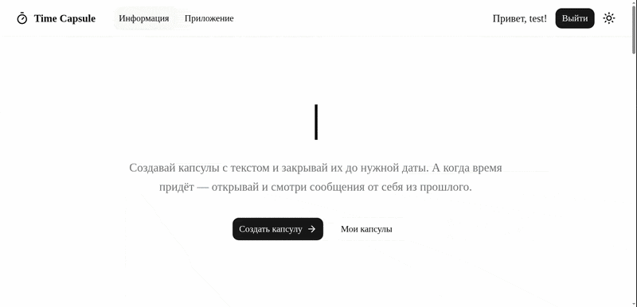

# Time Capsule

Веб-приложение для создания капсул времени с текстом, который становится доступен только после заранее указанной даты.

## 🚀 Демонстрация

  

## 🔗 Ссылки

- 🌐 [Демонстрационный сайт](https://time-capsule.denisermolaev.com/)
- 📦 [Backend](https://github.com/denis-ermolaev/time-capsule-fastapi-backend)
- 💻 [Frontend](https://github.com/denis-ermolaev/time-capsule-nextjs-frontend)

## 🔬 Особое внимание уделено качеству разработки:

- ИИ-агенты для код-review
- Высокопроизводительные инструменты от Astral: менеджер пакетов - uv, линтер и форматтер - ruff, анализатор типов и языковой сервер - ty
- Тесты (pytest)
- Pre-commit и pre-push хуки
- google style docstring и conventional commits

## ✨ Возможности

- Создание капсул времени
- Отложенное открытие по заданной дате
- JWT-аутентификация
- Асинхронный стек (FastAPI + asyncpg + SQLAlchemy async)
- Приватные и публичные капсулы
- Фильтрация, сортировка и пагинация списка капсул

## 🛠️ Стек технологий

### Backend

- FastAPI, SQLAlchemy, asyncpg, Alembic, Pydantic
- python-jose, passlib, bcrypt
- structlog, pydantic-settings

### Infrastructure

- Docker & Docker Compose
- GitHub Actions (CI/CD)
- uv, ruff, ty
- pytest + httpx + time-machine
- pre-commit

## 🛠️ Dev workflow

Настройка окружения:
1) Заполнить `.env`
2) Зависимости:
- Установить `docker` или `podman`, а также `uv`. После этого в папке проекта выполните `uv sync`.
3) pre-commit хуки:
- Установка хуков pre-commit `make pre-commit-install_host`, срабатывают автоматически при коммите или отправке изменений в онлайн репозиторий (тесты+остальное).
- Вызвать выполнение хуков `make pre-commit_all` (только для отслеживаемых файлов `git add .`).
4) Контейнеры:
- При обновлении зависимостей и при первоначальном запуске - `make compose_build` и `make compose_build_test`.

Основной workflow:
1) Запуск приложения и тестового окружения:
- Запуск основного контейнера `make compose_without_build`, далее миграции, если необходимы - `make make_migrations` и `make migrations`.
- Запуск тестового контейнера `make up_test` в начале работы и после `git push`.
2) Разработка: выполнение тестов - `make test` и `make test_docs`, FastAPI приложение доступно [здесь](https://localhost:8080/docs), просмотр логов приложения с помощью - `make logs_web`.
3) После рабочего процесса - остановка контейнеров - `make down_web`, `make down_test`.
